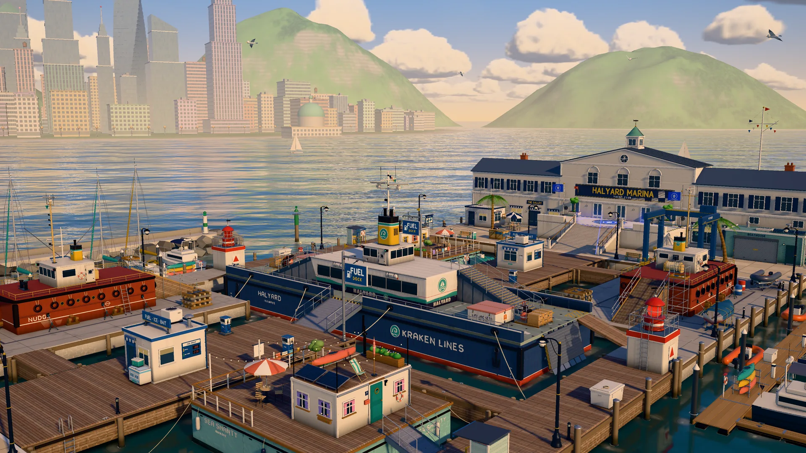
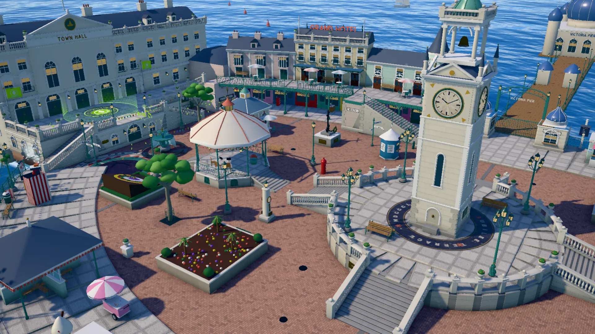
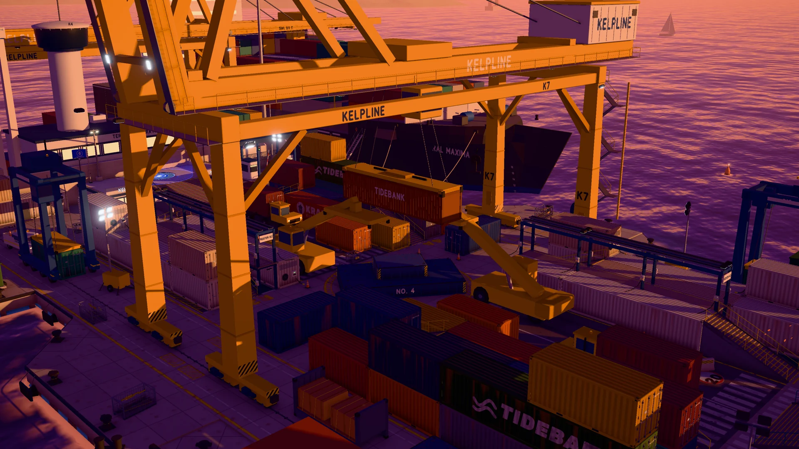

<p align="center">
  
</p>

<h1 align="center">INKWAVE</h1>

<p align="center">
  一款受《斯普拉遁》启发的原创 4v4 涂地射击游戏，在浏览器中即可游玩。<br>
  用墨水涂满地面，在己方墨水中畅游，抢占比对手更多的地盘。
</p>

<p align="center">
  <a href="https://inkwave-aah.pages.dev"><b>▶ 立即游玩</b></a> ·
  <a href="#controls">操作说明</a> ·
  <a href="#playing-online">在线联机</a> ·
  <a href="#running-locally">本地运行</a> ·
  <a href="#how-it-works">实现原理</a> ·
  <a href="CONTRIBUTING.md">参与贡献</a>
</p>

<p align="center">
  <a href="https://github.com/jaydendavisnc/inkwave/actions/workflows/ci.yml"></a>
  
  
  <a href="LICENSE"></a>
</p>

---

<a id="features"></a>

## 游戏特色

- **4v4 对战模式。** 涂地战以涂地面积决胜；区域控制则需要占领并守住当前区域，让计数从 100 递减，并包含轮换侧区、罚分和加时机制。机器人对手提供三种难度。
- **与好友在线联机。** 创建私人房间，分享五位房间码，最多八名玩家可带着各自的装备和造型在大厅集合。空位由机器人补齐；若有人中途掉线，机器人会接管其角色继续对战。
- **鱿鱼形态。** 按住对应按键即可潜入己方墨水，快速游动、补充墨水、攀爬涂墨墙面，还能以海豚跃般的动作跨越水道。
- **十二种武器，各具手感。** 包括喷墨枪、双焰双枪、华盖伞枪（霰弹射击与可发射的护盾）、爆泡枪、狂风旋转枪、闪光蓄力枪、潮线弓（三箭齐射、两段蓄力环）、浪涌滚筒、疾风毛刷、盐浪弯刀（蓄力可一击击倒）、海绵拳套（墨水拳击、蓄力跳跃与附墙）和舱底泼桶。任意主武器均可搭配 15 种副武器和 19 种特殊技能。
- **七张地图，昼夜两种氛围。** 潮汐广场、海带港码头、升帆港湾、盐田盆地、十字街市场、水闸运河和梯台高地，都以具体的场所为主题，各有独特布局。部分地图会在区域控制模式下调整少量场景结构。
- **如液体般流动的墨水。** 墨迹会扩散、沉降，新鲜墨水带有光泽并逐渐变干，墨滴沿墙面流下，游动还会在墨水表面留下尾流。
- **清晰直观的战术地图。** 按住 <kbd>Tab</kbd>，镜头便会上升，以移轴微缩景观的效果展示实时战场，并标出队友位置，点击标记即可超级跳跃。
- **衣柜与角色定制。** 自由选择角色的触手发型、头饰、面部外观和服装。
- **全部由程序生成。** 角色、动画、武器、纹理、道具、音效和音乐均通过代码生成。除两款字体外，不使用下载的素材。

<p align="center">
  
  
</p>

<a id="controls"></a>

## 操作说明

游戏界面支持英语和简体中文。在 **设置 → 游戏 → 语言**（Settings → Gameplay → Language）中即可即时切换，语言偏好会保存在当前设备上。

| 操作 | 键盘 / 鼠标 | 手柄 |
|---|---|---|
| 移动 | <kbd>W</kbd> <kbd>A</kbd> <kbd>S</kbd> <kbd>D</kbd> | 左摇杆 |
| 瞄准 | 移动鼠标 | 右摇杆 |
| 射击 | 鼠标左键 | RT |
| 鱿鱼形态 | <kbd>Shift</kbd> | LT |
| 跳跃 / 闪避翻滚 | <kbd>Space</kbd> | A |
| 副武器（炸弹） | 鼠标右键 / <kbd>E</kbd> | RB |
| 特殊技能 | <kbd>F</kbd> | Y |
| 地图与超级跳跃 | 按住 <kbd>Tab</kbd> 或 <kbd>M</kbd>，再按 <kbd>1</kbd>–<kbd>4</kbd> 或点击标记 | View |
| 暂停 | <kbd>Esc</kbd> | Start |

在线托管的 HTTPS 版本支持手柄。如果使用普通的 `http://` 局域网地址访问，浏览器会阻止调用 Gamepad API。

<a id="playing-online"></a>

## 在线联机

在主菜单选择 **在线联机**，然后 **创建房间**，将房间码分享给好友；也可以选择 **加入房间**，输入好友的房间码。
房主负责选择地图、时段、对战时长，以及是否用机器人填补空位；其他玩家选择队伍、武器和造型后即可准备。
房间内所有玩家都能实时看到阵容、表情动作和准备状态。

房间通过轻量级中继服务运行：它部署在 Cloudflare Worker 上，每个房间对应一个 Durable Object，代码位于 [`server/`](server)。
中继只负责转发消息。每位玩家在本地模拟自己的角色并持续发送状态，其他客户端则使用同一套动画系统，
在约延迟 0.1 秒的平滑时间线上渲染该角色。具体实现和测量工具见 [`docs/NET.md`](docs/NET.md)。

若要在自己的网络中联机，请在运行游戏的同时启动中继服务：

```bash
npm install      # 首次运行时安装依赖；中继通过 wrangler 运行
npm run relay    # ws://<本机地址>:8787
```

通过 `localhost` 或局域网地址打开的页面会自动使用该中继；也可通过 `?relay=wss://…` 指定其他中继地址。

<a id="running-locally"></a>

## 本地运行

无需构建，使用任意静态文件服务器即可运行。项目自带的服务器还支持局域网访问，并发送禁用缓存的响应头，避免模块更新后仍加载旧版本。

```bash
git clone https://github.com/jaydendavisnc/inkwave.git
cd inkwave
npm install      # 安装 Electron 和无头运行工具
npm start        # 启动桌面应用（Electron）
npm run serve    # 或启动网页版：http://localhost:8490
npm run package      # 为当前系统和架构打包桌面应用，输出到 dist/
npm run package:win  # 生成 Windows x64 应用目录和可分享的 ZIP 压缩包（在 Windows 上构建）
npm run package:mac  # 生成 macOS arm64 和 x64 应用
```

你可以将自己的音乐放入 `songs/`（见 [`songs/README.md`](songs/README.md)）；否则，游戏会播放程序生成的配乐。

桌面版默认使用简体中文，并连接到 `electron/config.json` 中配置的中继服务。
在 Windows 上，请完整解压 `dist/INKWAVE-1.1.0-Windows-x64.zip`，然后运行 `INKWAVE.exe`，并将配套文件保留在同一目录。
安装包已包含运行时，玩家无需安装 Node.js、Python，也无需单独运行本地中继。桌面外壳通过回环地址提供内置文件，
使用固定的本地源保存设置，同时兼容中继现有的本地客户端策略。
运行 `npm run test-desktop-server` 可检查静态服务器；打包后运行 `npm run test-desktop -- --network`，
可检查实际可执行文件，并通过两个临时客户端测试与已配置公共中继的连接。

常用 URL 参数：`?map=halyard&time=dusk` 用于选择地图和时段，`&autostart=180` 可跳过菜单直接进入 180 秒对战，`&autopilot` 则让机器人代为操控角色。

```bash
npm install      # 首次运行时安装无头运行工具所需的依赖
npm run check    # 检查所有模块的语法
npm run smoke    # 在无头 Chrome 中启动并自动游玩 8 秒，出现控制台错误则判定失败
npm run build    # 将游戏和实际导入的 three.js 附加模块整理到 dist/
npm run check-maps   # 检查所有地图布局及其区域控制版本
```

调试时可使用无头、静音模式运行机器人对战：`MAP=halyard MODE=turf SECS=180 npm run botlab`（见 [`tools/botlab/README.md`](tools/botlab/README.md)）。
启动中继后，`npm run net-test` 会让无头客户端进行一场真实对战，并报告各客户端实际渲染的内容
（见 [`docs/NET.md`](docs/NET.md#how-the-netcode-works-srcnetnetmatchjs)）。

<a id="how-it-works"></a>

## 实现原理

- **在纹理空间中绘制墨水。** 每个可涂色表面都在一张 4K 纹理图集中占据独立区域，GPU 将墨迹绘入图集，CPU 上的粗粒度网格则同步维护涂地得分和游戏逻辑查询。场景着色器将墨水叠加到表面，并单独处理墨层高度、光泽和湿润程度。见 [`src/world/paint.js`](src/world/paint.js) 和 [`src/world/inkShading.js`](src/world/inkShading.js)。
- **用数据定义地图。** 地图布局以箱体和斜坡列表描述半边战场，另半边由其旋转 180° 得到，确保双方拥有完全对称的场地。环境光遮蔽通过 `tools/bake-ao.mjs` 离线烘焙。见 [`src/world/maps.js`](src/world/maps.js)。
- **完全由程序生成角色。** 几何体、材质、包含 60 根骨骼的绑定，以及移动、鱿鱼形态、持械姿势和次级运动等全部动画，都由代码实现，并通过基于弹簧的姿态系统驱动。见 [`docs/RIG.md`](docs/RIG.md)。
- **通过事件连接各个系统。** 武器、角色和对战系统发送带类型的事件，特效、HUD 和音频系统订阅这些事件。接口约定见 [`docs/EVENTS.md`](docs/EVENTS.md) 和 [`docs/CONTRACTS.md`](docs/CONTRACTS.md)。
- **可复现的调试工具。** 游戏提供冻结与逐帧步进调试接口，使连续帧截图、操控特性测量和机器人模拟都能逐帧复现。相关工具为 `tools/film.py` 和 `tools/measure-handling.mjs`。

渲染使用 three.js r186，依赖随项目内置，并通过导入映射加载原生 ES 模块；同时结合 GTAO 环境光遮蔽、泛光和自定义调色后处理。

<a id="browser-support"></a>

## 浏览器支持

主要面向 Chrome 和 Edge，Firefox 也可使用。Safari 可以运行，但速度较慢。使用高画质预设时，建议配备独立显卡或较新的集成显卡；设置菜单也提供中、低画质选项。

<a id="contributing"></a>

## 参与贡献

欢迎提交 Issue 和 Pull Request。请先阅读 [CONTRIBUTING.md](CONTRIBUTING.md)，了解项目结构及提交前需要执行的检查。

<a id="license"></a>

## 许可证

[MIT](LICENSE) © 2026 Jayden Davis。INKWAVE 是独立项目，与任天堂无关联；Splatoon 是任天堂的商标。
